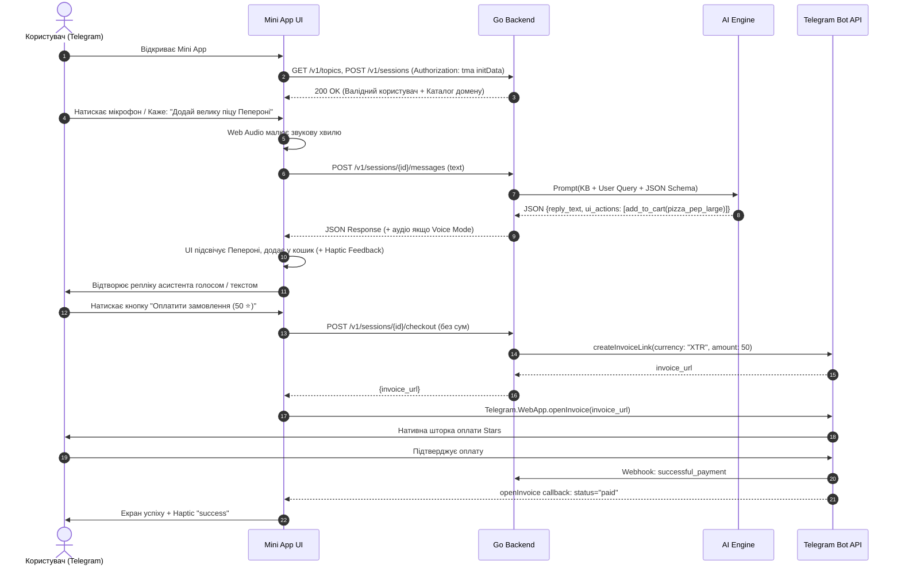

# v2v-tma — High-Level Design (HLD) & Architecture

> **Статус (2026-10-14): цільова архітектура.** v2v-tma — тонкий клієнт; «Go Backend» і «Domain Engine» на схемі нижче — це рушій у `v2v-demo` (`ENGINE_URL`). У цьому репозиторії зараз лише заглушка того ж контракту `/v1`; точний контракт — [`API.md`](API.md), статус і беклог — [`HANDOFF.md`](HANDOFF.md). Згадки `/api/*`, `reply_text`, `chi`, `telegram-bridge.js` тощо нижче — історичні.

Документ описує системну архітектуру, взаємодію компонентів, моделі даних та протоколи обміну між Telegram Mini App, Go бекендом, мовними моделями та Telegram Bot API.

---

## 1. Системний контекст (System Context)

```
       ┌────────────────────────────────────────────────────────┐
       │                   Telegram Client                      │
       │                                                        │
       │  ┌───────────────────────┐   ┌──────────────────────┐  │
       │  │  Bot Chat (Telegram)  │   │ Telegram Mini App UI │  │
       │  │   Inline Buttons      │   │  (HTML5/Tailwind/JS) │  │
       │  └──────────┬────────────┘   └──────────┬───────────┘  │
       └─────────────┼───────────────────────────┼──────────────┘
                     │                           │ HTTPS / WSS
                     │ Webhook / Long-Poll       │ initData + REST
                     ▼                           ▼
       ┌────────────────────────────────────────────────────────┐
       │                 v2v-tma Backend (Go)                   │
       │                                                        │
       │  ┌─────────────────────┐       ┌────────────────────┐  │
       │  │ Telegram Auth & Web │       │ Bot Handler        │  │
       │  │ (initData HMAC)     │       │ (Stars & Invoices) │  │
       │  └──────────┬──────────┘       └─────────┬──────────┘  │
       │             ▼                            ▼             │
       │  ┌──────────────────────────────────────────────────┐  │
       │  │        Domain Engine (Pizzeria, Auto, Barber...) │  │
       │  │        - In-Memory Catalog & Rules               │  │
       │  │        - LLM Grounding Gate & Intent Parser      │  │
       │  └──────────────────────────┬───────────────────────┘  │
       │                             ▼                          │
       │  ┌──────────────────────────────────────────────────┐  │
       │  │ Speech Tier (Dual Mode: Zero-Cost / On-Demand)   │  │
       │  │ - Text/Native Speech fallback (0 cost)           │  │
       │  │ - Cloud STT / Cached TTS (On-demand)             │  │
       │  └──────────────────────────────────────────────────┘  │
       └─────────────────────────────┬──────────────────────────┘
                                     │
              ┌──────────────────────┼──────────────────────┐
              ▼                      ▼                      ▼
       ┌─────────────┐       ┌───────────────┐       ┌─────────────┐
       │  OpenAI /   │       │   ElevenLabs  │       │  Telegram   │
       │  Ollama LLM │       │   / Azure TTS │       │  Payments   │
       │ (JSON Mode) │       │   (Cached)    │       │   (Stars)   │
       └─────────────┘       └───────────────┘       └─────────────┘
```

---

## 2. Ключові компоненти системи

### 2.1. Frontend: Telegram Mini App (TMA Client)
- **Технологічний стек:** Односторінковий легкий HTML5 застосунок із нативним JavaScript (ES6+) та TailwindCSS (компілюється в один оптимізований CSS-файл). Жодних важких залежностей.
- **Модулі клієнта:**
  1. `telegram-bridge.js`: Інтеграція з `window.Telegram.WebApp` (ініціалізація, `expand()`, `themeParams`, `HapticFeedback`, `MainButton`, передача `initData`).
  2. `audio-visualizer.js`: Web Audio API (AnalyserNode) для малювання плавного хвильового спектра при активації мікрофона.
  3. `speech-controller.js`: Керування подвійним режимом:
     - **Текстовий режим / Локальний Web Speech:** використання `webkitSpeechRecognition` та `speechSynthesis` безкоштовно на пристрої.
     - **Хмарний аудіо-режим:** запис аудіо (Opus) та відтворення хмарного потоку.
  4. `ui-mutator.js`: Отримання списку `ui_actions` від бекенду та виконання динамічних змін DOM (підсвічування картки товару, додавання до кошика, відкриття модалки).
  5. `cart-manager.js`: Клієнтський стан замовлення з розрахунком суми в гривнях та еквівалента в Telegram Stars.

### 2.2. Backend: Go Core Server (`v2v-tma`)
- **Маршрутизатор та HTTP-сервер:** Стандартна бібліотека Go `net/http` або легкий `chi`.
- **Безпека (Auth Gateway):**
  - Валідація `initData`:
    ```go
    // Формула Telegram:
    // secret_key = HMAC_SHA256("WebAppData", bot_token)
    // data_check_string = sorted key=value pairs (without hash)
    // calculated_hash = HMAC_SHA256(secret_key, data_check_string)
    ```
- **Domain & KB Manager:**
  - Базується на перевіреній структурі `topics/` з `v2v-demo`:
    - `pizzeria`: меню страв, інгредієнти, допи, правила доставки.
    - `barbershop`: перелік стрижок/догляду, час виконання, майстри.
    - `auto`: ТО, балансування, діагностика, комп'ютерні перевірки.
    - `lyapko`: аплікатори, валики, розміри, медичні рекомендації.
- **LLM Grounding & Tool Calling:**
  - Запит до LLM формується із системним промптом, що містить поточну базу знань домену.
  - Формат виводу: строго JSON Schema із полями `reply`, `intent`, `ui_actions`.

### 2.3. Платіжний модуль Telegram Stars
- Метод `POST /v1/sessions/{id}/checkout`:
  1. Клієнт не передає нічого: сервер бере власну копію кошика сесії та сам рахує суму.
  2. Сервер звертається до Telegram Bot API `createInvoiceLink`:
     - `title`: "Замовлення в Папа Пепе / Барбароса"
     - `description`: "Деталі замовлення: 2x Пепероні, 1x Кола"
     - `payload`: унікальний ідентифікатор транзакції `order_<uuid>`
     - `currency`: "XTR" (Telegram Stars)
     - `prices`: `[{"label": "Замовлення", "amount": 50}]`
  3. Сервер повертає клієнту `invoice_link`.
  4. Клієнт викликає `Telegram.WebApp.openInvoice(invoice_link)`.

---

## 3. Схема взаємодії (Sequence Diagram: Voice-to-UI + Stars Checkout)



---

## 4. Модель структурованих UI-дій (UI Action Protocol)

Відповідь бекенду на кожну репліку користувача містить уніфікований масив `ui_actions`, який клієнтський рушій інтерпретує локально:

```json
{
  "reply": "Чудовий вибір! Додав велику піцу Пепероні з подвійним сиром до вашого замовлення. Бажаєте напій чи соус?",
  "language": "uk",
  "intent": "add_to_cart",
  "ui_actions": [
    {
      "type": "HIGHLIGHT_ITEM",
      "payload": {
        "item_id": "pizza_peperoni",
        "duration_ms": 2000
      }
    },
    {
      "type": "ADD_TO_CART",
      "payload": {
        "item_id": "pizza_peperoni",
        "title": "Піца Пепероні (велика)",
        "price_uah": 320,
        "price_stars": 35,
        "quantity": 1
      }
    },
    {
      "type": "SUGGEST_ADDONS",
      "payload": {
        "suggested_ids": ["coca_cola_05", "sauce_garlic"]
      }
    }
  ]
}
```

---

## 5. Безпека та ізоляція

1. **Криптографічна валідація:** Жодна мутація стану та жоден платіжний запит не приймаються без валідності `hash` з `initData`.
2. **Серверна перевірка цін:** Клієнт надсилає лише `item_id` та `quantity`. Сума в гривнях та еквівалент у Stars **завжди розраховуються на сервері** на основі авторитарного прайс-листа.
3. **Обмеження вартості викликів (Rate Limiting & Cost Guard):**
   - Текстові запити обробляються через локальні/дешеві інстанси або оптимізований prompt cache.
   - Хмарні TTS виклики лімітуються по сесії (не більше 5 запитів на демо-сесію, далі — нативний Web Speech або кеш).
